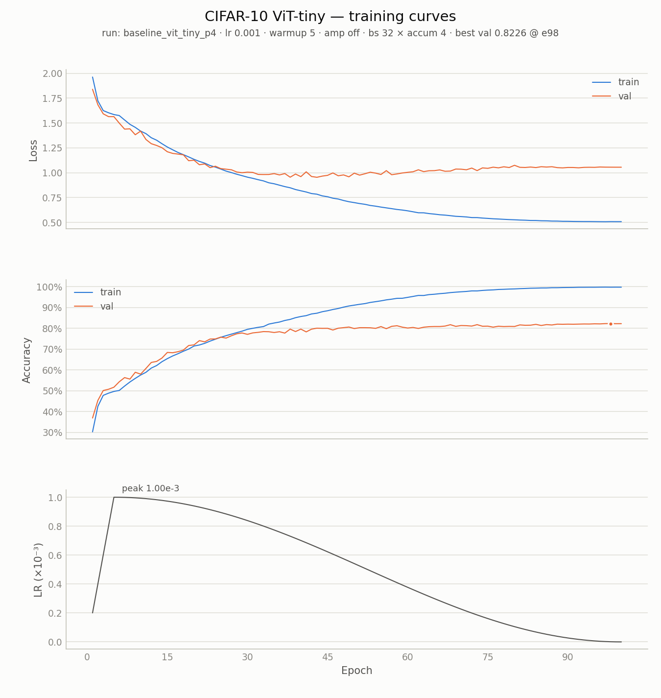

# Vision Transformers from Scratch

**ViT → Swin → MAE, implemented line by line in pure PyTorch, trained on CIFAR-10, and explained in English and Chinese.**

[English](#english) · [中文](#中文)


---

## English

### Why this repository

Most ViT tutorials either call a library or paste a whole model without explaining the shape flow. This repository takes the slower, more useful path:

- **Build every core component by hand**: scaled dot-product attention, multi-head self-attention, LayerNorm, Pre-LN/Post-LN blocks, patch embedding, cls/position embeddings, Swin window attention and shifted windows, PatchMerging, relative position bias, and the MAE encoder/decoder.
- **Verify against references**: numerical tests compare the hand-written implementation with `vit-pytorch`, brute-force masks, and analytical parameter counts.
- **Train on a laptop**: a ViT-tiny baseline reaches **81.56%** test accuracy on CIFAR-10; Swin matches it with about **1/11** of the MACs; MAE pretraining + fine-tuning reaches **90.87%**.
- **Learn the engineering, not only the model**: data splits, normalization, augmentation, AdamW, warmup + cosine, label smoothing, AMP, gradient clipping, reproducibility, checkpointing, calibration, McNemar tests, and bootstrap confidence intervals.
- **Read the reasoning**: every stage has a bilingual Q&A document with questions, answers, common mistakes, and the evidence behind each claim.

The code is deliberately small enough to read end to end. Every source file is in English; documentation is bilingual.

**Who this is for.** Learners who want to get started with ViT, readers who want to understand how Transformers are implemented concretely, or anyone beginning a computer-vision deep-learning course.

**Scope.** This is a CIFAR-10-scale teaching project, not a SOTA benchmark or a production library. Results are single-seed and the limitations are stated explicitly in [`docs/experiments.md`](docs/experiments.md). The goal is understanding and reproducible engineering, and you are welcome to run further experiments.

### Results

All numbers are single-run test-set results on CIFAR-10 (10,000 images), using the same data split and evaluation protocol.

| Model | Params | MACs / image | Test acc | Macro F1 | ROC-AUC | NLL | ECE |
|---|---:|---:|---:|---:|---:|---:|---:|
| ViT-tiny baseline (p4, d192, L12) | 5.36M | 365.1M | 0.8156 | 0.8152 | 0.9525 | 0.7323 | 0.0462 |
| ViT + dropout/drop-path 0.05 | 5.36M | 365.1M | 0.8320 | 0.8315 | 0.9684 | 0.6210 | 0.0479 |
| ViT + dropout/drop-path 0.10 | 5.36M | 365.1M | 0.8368 | 0.8362 | 0.9787 | 0.5645 | 0.0570 |
| Swin-CIFAR (3 stages, windows 4/2/2) | 5.41M | 33.1M | 0.8201 | 0.8198 | 0.9651 | 0.6520 | 0.0544 |
| MAE pretrain + fine-tune (100 + 100 epochs) | 5.36M | 365.1M | **0.9087** | **0.9087** | **0.9838** | **0.3976** | 0.0585 |



*ViT baseline training curves (100 epochs). / ViT 基线训练曲线（100 epoch）。*

Key comparisons:

- **Swin vs ViT**: +0.45 pp, McNemar exact p = 0.267, paired bootstrap 95% CI [−1.26, +0.34] pp. The difference is **not** statistically significant; Swin's advantage here is efficiency, not accuracy.
- **MAE vs from-scratch ViT**: +9.31 pp, McNemar b/c = 1196/265, p = 2.92e-141, bootstrap 95% CI [+8.59, +10.03] pp. Capacity is unchanged after fine-tuning; the gain comes from the pretrained representation and initialization.
- **Dropout 0.05 vs 0.10**: 0.48 pp on test, p = 0.155 — not significant with one run per setting.

The figures in [`docs/assets/`](docs/assets) are generated by the scripts in this repository.

### Quick start

Requirements: Python 3.10–3.12, PyTorch 2.x, and about 2 GB of free disk space for CIFAR-10 and checkpoints. A GPU is optional; CUDA and Apple MPS are used automatically when available.

```bash
git clone https://github.com/wickedlin/vit-from-scratch.git
cd vit-from-scratch
python -m venv .venv
```

Activate the environment:

```bash
# macOS / Linux
source .venv/bin/activate
# Windows (PowerShell)
.venv\Scripts\Activate.ps1
# Windows (cmd)
.venv\Scripts\activate.bat
```

Install PyTorch for your platform, then the course dependencies:

```bash
# Windows + NVIDIA CUDA (adjust cuXXX to your driver)
pip install torch torchvision --index-url https://download.pytorch.org/whl/cu129
# macOS (Apple Silicon, MPS)
pip install torch torchvision
# CPU only
pip install torch torchvision --index-url https://download.pytorch.org/whl/cpu

pip install -r requirements.txt
pip install -e .
```

Check the environment:

```bash
python scripts/check_env.py
```

Run the fast tests first:

```bash
python -m unittest discover -s tests -p "test_smoke.py" -v
```

Run the full test suite (the first run downloads CIFAR-10, about 170 MB):

```bash
python -m unittest discover -s tests -v
```

Train a 1-epoch smoke run:

```bash
python -m vit_from_scratch.train --epochs 1 --batch-size 32 --amp auto --num-workers 0 --output-dir experiments/smoke
```

Train the 100-epoch ViT baseline (about 4 hours on the original RTX 4060 laptop GPU; use `--epochs 10` for a quick look):

```bash
python -m vit_from_scratch.train --epochs 100 --batch-size 32 --accum-steps 4 --lr 1e-3 --weight-decay 0.05 --warmup-epochs 5 --label-smoothing 0.1 --amp auto --num-workers 0 --output-dir experiments/vit_baseline
```

Evaluate on the test split:

```bash
python scripts/eval_checkpoint.py --checkpoint experiments/vit_baseline/best.pt --split test
```

Plot the training curves:

```bash
python scripts/plot_metrics.py --metrics experiments/vit_baseline/metrics.jsonl
```

Train Swin:

```bash
python scripts/train_swin.py --epochs 100 --batch-size 32 --accum-steps 4 --lr 1e-3 --amp auto --num-workers 0 --output-dir experiments/swin_baseline
```

Run the MAE pipeline:

```bash
python scripts/pretrain_mae.py --epochs 100 --batch-size 64 --accum-steps 2 --lr 1e-3 --mask-ratio 0.75 --norm-pix-loss --amp auto --num-workers 0 --output-dir experiments/mae_pretrain
python scripts/finetune_mae.py --mae-checkpoint experiments/mae_pretrain/best.pt --epochs 100 --batch-size 32 --accum-steps 4 --lr 1e-3 --amp auto --num-workers 0 --output-dir experiments/mae_finetune
```

A quick CPU smoke test for MAE:

```bash
python scripts/pretrain_mae.py --epochs 1 --max-steps 20 --val-batches 5 --batch-size 16 --accum-steps 2 --device cpu --output-dir experiments/mae_smoke
```

### Project structure

```text
vit-from-scratch/
├── src/vit_from_scratch/       # The implementation you are here to read
│   ├── attention.py            # SDPA (naive + vectorized), multi-head self-attention
│   ├── transformer.py          # LayerNorm, MLP, DropPath, Pre/Post-LN TransformerBlock
│   ├── vit.py                  # PatchEmbed, cls token, position embeddings, ViT
│   ├── data.py                 # CIFAR-10 download, stratified split, transforms, DataLoader
│   ├── optim.py                # AdamW parameter groups, warmup + cosine, label smoothing
│   ├── amp.py                  # AMP dtype selection, GradScaler, micro-batch/optimizer step
│   ├── train.py                # Training loop, evaluation, checkpoints, JSONL logs
│   ├── metrics.py              # Accuracy, P/R/F1, ROC/PR, NLL/Brier/ECE, McNemar, bootstrap
│   ├── swin.py                 # Window attention, shifted windows, PatchMerging, Swin
│   ├── mae.py                  # Random masking, MAE encoder/decoder, reconstruction loss
│   └── utils.py                # Device selection and seeding
├── tests/                      # Numerical, gradient, shape, and smoke tests
├── scripts/                    # Training, evaluation, profiling, and diagnostic entry points
├── docs/
│   ├── curriculum.md           # Stage-by-stage learning path and acceptance criteria
│   ├── units.md                # Unit-by-unit checklist: do, answer, produce, pass
│   ├── architecture.md         # Module map, tensor shapes, and data flow
│   ├── experiments.md          # Full results, protocol, and limitations
│   ├── project-map.md          # File checklist and stage-to-file mapping
│   ├── qa/                     # Bilingual Q&A for every stage
│   └── assets/                 # Figures used by the documentation
├── pyproject.toml
├── requirements.txt
└── LICENSE
```

`data/`, `experiments/`, `reports/`, and all model weights are ignored by Git and created locally when you run the code.

### Learning path

| Stage | Topic | Core files | Q&A |
|---|---|---|---|
| S0 | Environment, device abstraction, shape literacy | `scripts/check_env.py`, `scripts/shape_trace.py`, `src/vit_from_scratch/utils.py` | [S0](docs/qa/s0-environment.md) |
| S1 | Attention, LayerNorm, Pre/Post-LN, Transformer block | `attention.py`, `transformer.py` | [S1](docs/qa/s1-attention.md) |
| S2 | Patch embedding, cls/position embeddings, full ViT | `vit.py` | [S2](docs/qa/s2-vit.md) |
| S3 | CIFAR-10 pipeline, optimization, AMP, debugging, evaluation | `data.py`, `optim.py`, `amp.py`, `train.py`, `metrics.py` | [S3](docs/qa/s3-training.md) |
| S4 | Swin: windows, shifted windows, PatchMerging, relative bias | `swin.py` | [S4](docs/qa/s4-swin.md) |
| S5 | MAE: masking, asymmetric encoder/decoder, pretraining + fine-tuning | `mae.py` | [S5](docs/qa/s5-mae.md) |
| S6 | Research judgment: claims, metrics, diagnosis, AI-code verification | — | [S6](docs/qa/s6-judgment.md) |

The Q&A documents are not answer keys for a quiz. Each question targets a mechanism, a failure mode, or a piece of evidence, and the answer includes the reasoning and the common misconception it corrects.

### Reproducibility and evaluation protocol

- The train/validation split is **stratified by class** and fixed at `seed=42`; the training seed controls shuffling and augmentation order. This keeps model comparisons on the same split.
- CIFAR-10 has 50,000 training images: 45,000 train / 5,000 validation. The 10,000-image test split is used only for final evaluation.
- Normalization statistics are computed from the **original training set before augmentation**; using validation or test images would leak information.
- Every run writes `config.json`, `model_config.json`, `metrics.jsonl`, `best.pt`, and `last.pt` under `experiments/<run>/`.
- Evaluation collects all logits once, then computes nonlinear metrics globally — never by averaging batch-level P/R/F1 or ECE.
- Model comparisons use **paired McNemar tests** on the same test samples, **paired bootstrap** confidence intervals, and Holm correction when comparing more than two models.
- Statistical tests condition on the two trained models; they do **not** measure seed-to-seed variance. The reported numbers are single-seed results.

### Windows and macOS notes

- `get_device()` selects **CUDA → MPS → CPU**. There is no hard-coded `.cuda()`.
- `--amp auto` uses bf16/fp16 only on CUDA; on Apple MPS and CPU it stays in fp32. Use `--amp bf16` or `--amp fp16` only when you know the device supports it.
- `pin_memory` is enabled only on CUDA. `--num-workers 0` is the simplest cross-platform choice; Windows users may need it if multiprocessing workers behave unexpectedly.
- All paths use `pathlib` and are relative to the repository root. All scripts have an `if __name__ == "__main__"` guard, which is required for Windows multiprocessing.
- Checkpoints contain `state_dict` tensors only and load with `map_location`, so a checkpoint saved on one device can be opened on another.
- CUDA-only benchmarks (`scripts/bench_amp.py`, the memory probe in `scripts/profile_vit.py`) skip or exit cleanly when CUDA is unavailable.
- On first use, torchvision downloads CIFAR-10 to `data/`. If your network blocks the official mirror, download `cifar-10-python.tar.gz` manually and place the extracted `cifar-10-batches-py/` directory under `data/`; torchvision will detect it and skip the download.
- On macOS 27, some early SciPy wheels may fail to import with a `__thread_bss` dyld error. Upgrade SciPy (`pip install -U scipy`) or use a current conda-forge build; this is an environment issue, not a model issue.
- The repository is tested on macOS (Apple Silicon, MPS) and is written for Windows (CUDA/CPU) from the start. CUDA-only tests skip automatically on macOS.

### Documentation

- [Learning path and acceptance criteria](docs/curriculum.md)
- [Unit-by-unit learning plan](docs/units.md)
- [Architecture and tensor shapes](docs/architecture.md)
- [Experiments, results, and limitations](docs/experiments.md)
- [File checklist and stage mapping](docs/project-map.md)
- [Q&A: S0 environment](docs/qa/s0-environment.md) · [S1 attention](docs/qa/s1-attention.md) · [S2 ViT](docs/qa/s2-vit.md) · [S3 training](docs/qa/s3-training.md) · [S4 Swin](docs/qa/s4-swin.md) · [S5 MAE](docs/qa/s5-mae.md) · [S6 judgment](docs/qa/s6-judgment.md) · [S6 module exam](docs/qa/s6-module-exam.md)

### References

- Vaswani et al., *Attention Is All You Need*, 2017.
- Dosovitskiy et al., *An Image is Worth 16x16 Words: Transformers for Image Recognition at Scale*, 2020.
- Touvron et al., *Training data-efficient image transformers & distillation through attention* (DeiT), 2020.
- Liu et al., *Swin Transformer: Hierarchical Vision Transformer using Shifted Windows*, 2021.
- He et al., *Masked Autoencoders Are Scalable Vision Learners*, 2021.
- Xiong et al., *On Layer Normalization in the Transformer Architecture*, 2020.
- lucidrains/vit-pytorch: <https://github.com/lucidrains/vit-pytorch> (used as a numerical reference, not as the implementation).

### License

MIT. See [LICENSE](LICENSE).

---

## 中文

### 为什么做这个仓库

大多数 ViT 教程要么直接调用库，要么贴一整份模型却不解释 shape 如何流动。这个仓库选择更慢但更有用的路线：

- **手写每个核心组件**：scaled dot-product attention、多头自注意力、LayerNorm、Pre-LN/Post-LN block、patch embedding、cls/位置编码、Swin 窗口注意力与 shifted window、PatchMerging、相对位置偏置，以及 MAE encoder/decoder。
- **与参考实现对照验证**：用数值测试对比手写实现与 `vit-pytorch`、用暴力枚举核对 mask、用手推公式核对参数量。
- **在笔记本上训练**：ViT-tiny 基线在 CIFAR-10 上达到 **81.56%** test accuracy；Swin 用约 **1/11** 的 MACs 达到同一水平；MAE 预训练 + 微调达到 **90.87%**。
- **不只学模型，也学工程**：数据划分、归一化、增强、AdamW、warmup + cosine、label smoothing、AMP、梯度裁剪、可复现性、checkpoint、校准、McNemar 检验与 bootstrap 置信区间。
- **读得懂推理过程**：每个阶段都有一份中英文 Q&A，包含问题、答案、常见误解和结论背后的证据。

代码刻意保持“可以从前到后读完”的规模。所有源码注释和 docstring 使用英文；文档中英文双语。

**适合谁。** 想入门ViT的学习者，想了解transformer的具体实现或者开始CV的深度学习课程的人。

**范围。** 这是一个 CIFAR-10 规模的教学项目，不是 SOTA benchmark，也不是生产库。结果是单 seed，局限在 [`docs/experiments.md`](docs/experiments.md) 中明确写出。目标是理解与可复现的工程，也欢迎大家做更多的实验。

### 实验结果

以下均为 CIFAR-10 test split（10,000 张）的单次运行结果，使用同一数据划分与评估协议。

| 模型 | 参数量 | 单图 MACs | Test acc | Macro F1 | ROC-AUC | NLL | ECE |
|---|---:|---:|---:|---:|---:|---:|---:|
| ViT-tiny 基线（p4, d192, L12） | 5.36M | 365.1M | 0.8156 | 0.8152 | 0.9525 | 0.7323 | 0.0462 |
| ViT + dropout/drop-path 0.05 | 5.36M | 365.1M | 0.8320 | 0.8315 | 0.9684 | 0.6210 | 0.0479 |
| ViT + dropout/drop-path 0.10 | 5.36M | 365.1M | 0.8368 | 0.8362 | 0.9787 | 0.5645 | 0.0570 |
| Swin-CIFAR（3 stages，窗口 4/2/2） | 5.41M | 33.1M | 0.8201 | 0.8198 | 0.9651 | 0.6520 | 0.0544 |
| MAE 预训练 + 微调（100 + 100 epoch） | 5.36M | 365.1M | **0.9087** | **0.9087** | **0.9838** | **0.3976** | 0.0585 |

关键对比：

- **Swin vs ViT**：+0.45 pp，McNemar 精确检验 p = 0.267，配对 bootstrap 95% CI [−1.26, +0.34] pp。差异**不显著**；Swin 在这里的优势是效率，不是精度。
- **MAE vs 从零训练 ViT**：+9.31 pp，McNemar b/c = 1196/265，p = 2.92e-141，bootstrap 95% CI [+8.59, +10.03] pp。微调后参数量不变，增益来自预训练表示与初始化，而不是容量变大。
- **Dropout 0.05 vs 0.10**：test 差 0.48 pp，p = 0.155；每个设置只有一次运行，不能断言谁更好。

[`docs/assets/`](docs/assets) 中的图均由本仓库脚本生成。

### 快速开始

环境要求：Python 3.10–3.12、PyTorch 2.x，以及约 2 GB 可用磁盘空间（CIFAR-10 与 checkpoint）。GPU 不是必需；有 CUDA 或 Apple MPS 时会自动使用。

```bash
git clone https://github.com/wickedlin/vit-from-scratch.git
cd vit-from-scratch
python -m venv .venv
```

激活环境：

```bash
# macOS / Linux
source .venv/bin/activate
# Windows (PowerShell)
.venv\Scripts\Activate.ps1
# Windows (cmd)
.venv\Scripts\activate.bat
```

先按平台安装 PyTorch，再安装课程依赖：

```bash
# Windows + NVIDIA CUDA（把 cuXXX 换成与驱动匹配的版本）
pip install torch torchvision --index-url https://download.pytorch.org/whl/cu129
# macOS（Apple Silicon，MPS）
pip install torch torchvision
# 仅 CPU
pip install torch torchvision --index-url https://download.pytorch.org/whl/cpu

pip install -r requirements.txt
pip install -e .
```

检查环境：

```bash
python scripts/check_env.py
```

先跑快速测试：

```bash
python -m unittest discover -s tests -p "test_smoke.py" -v
```

跑完整测试（首次会下载 CIFAR-10，约 170 MB）：

```bash
python -m unittest discover -s tests -v
```

训练 1 个 epoch 的 smoke 运行：

```bash
python -m vit_from_scratch.train --epochs 1 --batch-size 32 --amp auto --num-workers 0 --output-dir experiments/smoke
```

训练 100-epoch ViT 基线（在原 RTX 4060 笔记本 GPU 上约 4 小时；想快速看曲线可用 `--epochs 10`）：

```bash
python -m vit_from_scratch.train --epochs 100 --batch-size 32 --accum-steps 4 --lr 1e-3 --weight-decay 0.05 --warmup-epochs 5 --label-smoothing 0.1 --amp auto --num-workers 0 --output-dir experiments/vit_baseline
```

在 test split 上评估：

```bash
python scripts/eval_checkpoint.py --checkpoint experiments/vit_baseline/best.pt --split test
```

画训练曲线：

```bash
python scripts/plot_metrics.py --metrics experiments/vit_baseline/metrics.jsonl
```

训练 Swin：

```bash
python scripts/train_swin.py --epochs 100 --batch-size 32 --accum-steps 4 --lr 1e-3 --amp auto --num-workers 0 --output-dir experiments/swin_baseline
```

运行 MAE 流程：

```bash
python scripts/pretrain_mae.py --epochs 100 --batch-size 64 --accum-steps 2 --lr 1e-3 --mask-ratio 0.75 --norm-pix-loss --amp auto --num-workers 0 --output-dir experiments/mae_pretrain
python scripts/finetune_mae.py --mae-checkpoint experiments/mae_pretrain/best.pt --epochs 100 --batch-size 32 --accum-steps 4 --lr 1e-3 --amp auto --num-workers 0 --output-dir experiments/mae_finetune
```

MAE 的 CPU 快速冒烟：

```bash
python scripts/pretrain_mae.py --epochs 1 --max-steps 20 --val-batches 5 --batch-size 16 --accum-steps 2 --device cpu --output-dir experiments/mae_smoke
```

### 项目结构

```text
vit-from-scratch/
├── src/vit_from_scratch/       # 你真正要读的实现
│   ├── attention.py            # SDPA（naive + 向量化）、多头自注意力
│   ├── transformer.py          # LayerNorm、MLP、DropPath、Pre/Post-LN TransformerBlock
│   ├── vit.py                  # PatchEmbed、cls token、位置编码、ViT
│   ├── data.py                 # CIFAR-10 下载、分层划分、transform、DataLoader
│   ├── optim.py                # AdamW 参数分组、warmup + cosine、label smoothing
│   ├── amp.py                  # AMP dtype 选择、GradScaler、micro-batch/optimizer step
│   ├── train.py                # 训练循环、评估、checkpoint、JSONL 日志
│   ├── metrics.py              # Accuracy、P/R/F1、ROC/PR、NLL/Brier/ECE、McNemar、bootstrap
│   ├── swin.py                 # 窗口注意力、shifted window、PatchMerging、Swin
│   ├── mae.py                  # 随机 masking、MAE encoder/decoder、重建损失
│   └── utils.py                # 设备选择与随机种子
├── tests/                      # 数值、梯度、shape 与 smoke 测试
├── scripts/                    # 训练、评估、profiling 与诊断入口
├── docs/
│   ├── curriculum.md           # 分阶段学习路径与验收标准
│   ├── units.md                # 逐单元清单：做什么、答什么、产出什么、怎么通过
│   ├── architecture.md         # 模块地图、张量 shape 与数据流
│   ├── experiments.md          # 完整结果、协议与局限
│   ├── project-map.md          # 文件清单与阶段映射
│   ├── qa/                     # 每个阶段的双语问答
│   └── assets/                 # 文档使用的图
├── pyproject.toml
├── requirements.txt
└── LICENSE
```

`data/`、`experiments/`、`reports/` 与所有模型权重都被 Git 忽略，运行代码时在本地生成。

### 学习路径

| 阶段 | 主题 | 核心文件 | 问答 |
|---|---|---|---|
| S0 | 环境、设备抽象、形状素养 | `scripts/check_env.py`、`scripts/shape_trace.py`、`src/vit_from_scratch/utils.py` | [S0](docs/qa/s0-environment.md) |
| S1 | Attention、LayerNorm、Pre/Post-LN、Transformer block | `attention.py`、`transformer.py` | [S1](docs/qa/s1-attention.md) |
| S2 | Patch embedding、cls/位置编码、完整 ViT | `vit.py` | [S2](docs/qa/s2-vit.md) |
| S3 | CIFAR-10 管线、优化、AMP、调试、评估 | `data.py`、`optim.py`、`amp.py`、`train.py`、`metrics.py` | [S3](docs/qa/s3-training.md) |
| S4 | Swin：窗口、shifted window、PatchMerging、相对偏置 | `swin.py` | [S4](docs/qa/s4-swin.md) |
| S5 | MAE：masking、非对称 encoder/decoder、预训练 + 微调 | `mae.py` | [S5](docs/qa/s5-mae.md) |
| S6 | 研究判断力：claim、指标、诊断、AI 代码验证 | — | [S6](docs/qa/s6-judgment.md) |

问答文档不是考试答案。每道题都针对一个机制、一个失败模式或一条证据，答案会解释推理过程以及它纠正的常见误解。

### 可复现性与评估协议

- 训练/验证划分按类别分层，固定为 `seed=42`；训练 seed 控制 shuffle 与增强顺序。这样不同模型始终在同一个 split 上比较。
- CIFAR-10 有 50,000 张训练图：45,000 train / 5,000 validation。10,000 张 test 只在最终评估时使用。
- 归一化统计量来自**增强前的原始训练集**；使用 val/test 图像会泄漏信息。
- 每次运行在 `experiments/<run>/` 下写 `config.json`、`model_config.json`、`metrics.jsonl`、`best.pt`、`last.pt`。
- 评估先收集整个 split 的 logits，再全局计算非线性指标——不要按 batch 算 P/R/F1 或 ECE 再平均。
- 模型比较使用同一批 test 样本上的**配对 McNemar 检验**、**配对 bootstrap** 置信区间；多模型比较时做 Holm 校正。
- 统计检验条件于两个已训练模型，**不**衡量 seed 之间的方差。表中是单 seed 结果。

### Windows 与 macOS 注意事项

- `get_device()` 按 **CUDA → MPS → CPU** 选择设备，没有硬编码 `.cuda()`。
- `--amp auto` 只在 CUDA 上使用 bf16/fp16；Apple MPS 与 CPU 保持 fp32。只有确认设备支持时才显式用 `--amp bf16` 或 `--amp fp16`。
- `pin_memory` 只在 CUDA 上开启。`--num-workers 0` 是最简单的跨平台选择；Windows 上如果多进程 worker 行为异常，请用它。
- 所有路径使用 `pathlib` 且相对于仓库根目录。所有脚本都有 `if __name__ == "__main__"` 保护，这是 Windows 多进程所必需的。
- checkpoint 只包含 `state_dict` 张量，并用 `map_location` 加载；在一个设备上保存的 checkpoint 可以在另一个设备上打开。
- 仅 CUDA 的 benchmark（`scripts/bench_amp.py`、`scripts/profile_vit.py` 的显存探针）在无 CUDA 时会跳过或正常退出。
- 首次运行时 torchvision 会把 CIFAR-10 下载到 `data/`。如果网络无法访问官方源，可手动下载 `cifar-10-python.tar.gz`，把解压后的 `cifar-10-batches-py/` 放到 `data/` 下；torchvision 检测到后会跳过下载。
- macOS 27 上，较早的 SciPy wheel 可能因 `__thread_bss` dyld 错误无法导入。升级 SciPy（`pip install -U scipy`）或使用当前的 conda-forge 构建；这是环境问题，不是模型问题。
- 仓库已在 macOS（Apple Silicon，MPS）上测试，并从一开始就按 Windows（CUDA/CPU）兼容编写。仅 CUDA 的测试在 macOS 上会自动跳过。

### 文档

- [学习路径与验收标准](docs/curriculum.md)
- [逐单元学习计划](docs/units.md)
- [架构与张量 shape](docs/architecture.md)
- [实验、结果与局限](docs/experiments.md)
- [文件清单与阶段映射](docs/project-map.md)
- [问答：S0 环境](docs/qa/s0-environment.md) · [S1 Attention](docs/qa/s1-attention.md) · [S2 ViT](docs/qa/s2-vit.md) · [S3 训练](docs/qa/s3-training.md) · [S4 Swin](docs/qa/s4-swin.md) · [S5 MAE](docs/qa/s5-mae.md) · [S6 判断力](docs/qa/s6-judgment.md) · [S6 模块口试](docs/qa/s6-module-exam.md)

### 参考资料

- Vaswani et al., *Attention Is All You Need*, 2017.
- Dosovitskiy et al., *An Image is Worth 16x16 Words: Transformers for Image Recognition at Scale*, 2020.
- Touvron et al., *Training data-efficient image transformers & distillation through attention*（DeiT）, 2020.
- Liu et al., *Swin Transformer: Hierarchical Vision Transformer using Shifted Windows*, 2021.
- He et al., *Masked Autoencoders Are Scalable Vision Learners*, 2021.
- Xiong et al., *On Layer Normalization in the Transformer Architecture*, 2020.
- lucidrains/vit-pytorch：<https://github.com/lucidrains/vit-pytorch>（仅作为数值参考，不是本项目的实现）。

### 许可证

MIT，见 [LICENSE](LICENSE)。
