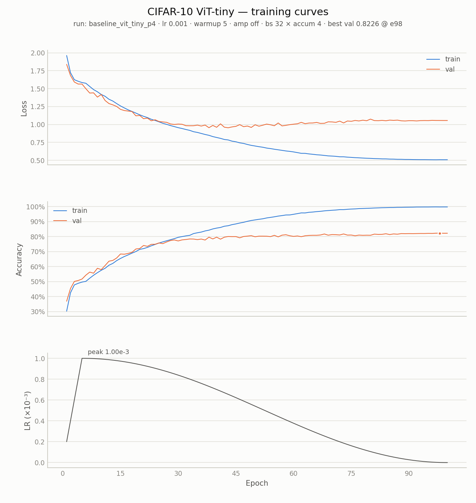
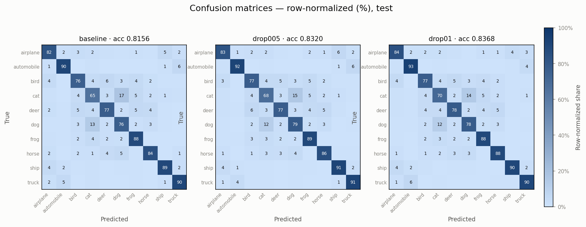
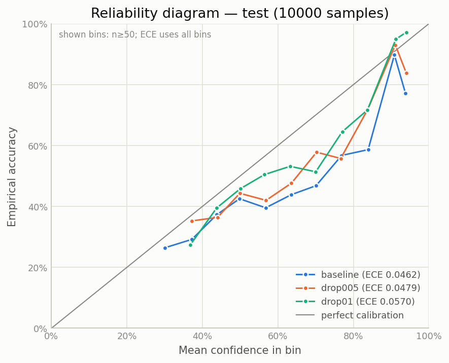
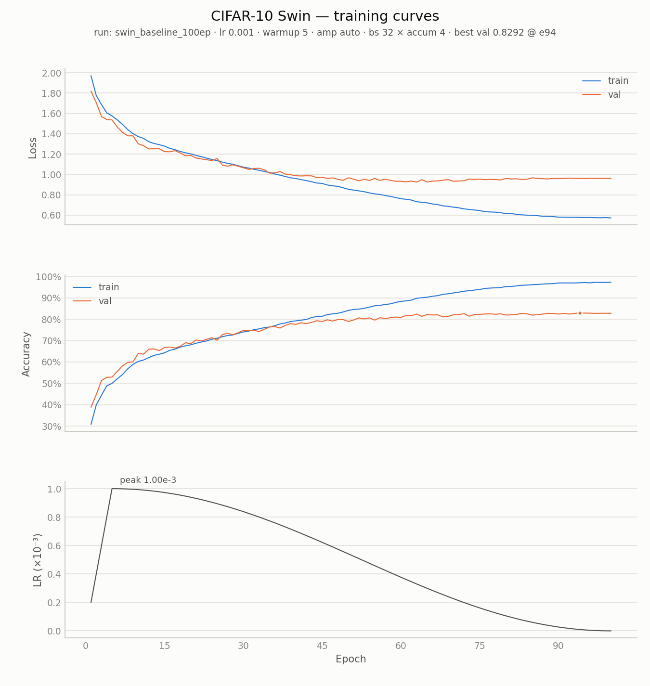
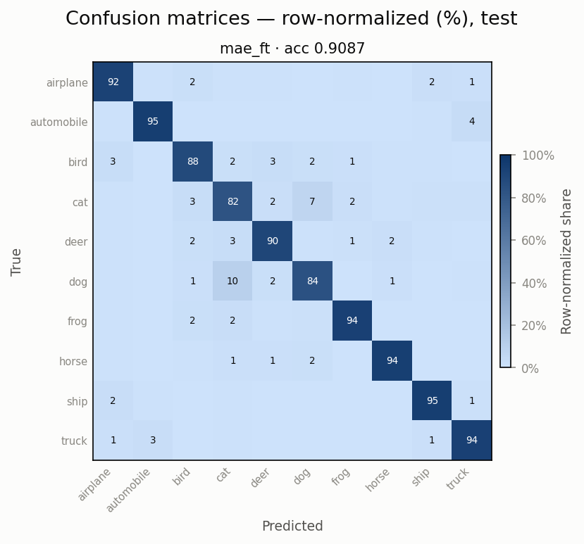
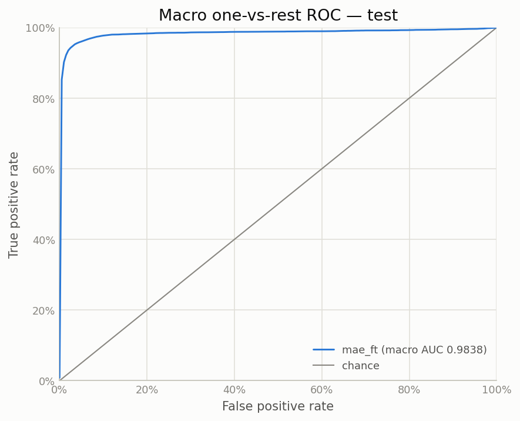

# Experiments, Results, and Limitations / 实验、结果与局限

[English](#english) · [中文](#中文)

All experiments use CIFAR-10 and the same evaluation protocol: 45,000 train / 5,000 validation / 10,000 test, normalization from the original training set, and test metrics computed once over the full split. Results are single-seed runs; the statistical tests condition on the trained models and do not estimate seed variance.

所有实验都使用 CIFAR-10 和同一评估协议：45,000 train / 5,000 validation / 10,000 test，归一化统计量来自原始训练集，test 指标在全量 split 上一次算出。结果是单 seed 运行；统计检验条件于已训练模型，不估计 seed 方差。

---

## English

### Protocol

| Item | Setting |
|---|---|
| Dataset | CIFAR-10, 32×32 RGB, 10 classes |
| Split | Stratified 45k train / 5k val from the 50k training set; 10k test |
| Normalization | Mean `(0.4914, 0.4822, 0.4465)`, std `(0.2470, 0.2435, 0.2616)` |
| Train augmentation | RandomCrop(32, padding=4, reflect) + RandomHorizontalFlip |
| Optimizer | AdamW, weight decay 0.05 on matrices only |
| Schedule | 5-epoch linear warmup + cosine decay |
| Label smoothing | 0.1 |
| Gradient clipping | Global L2 norm 1.0, after unscaling |
| Batch | 32 × 4 gradient accumulation = effective 128 |
| Checkpoint selection | Best validation accuracy |
| Comparison | McNemar exact test, paired bootstrap 2000 resamples, Holm correction across pairs |

The split seed is fixed at 42. The training seed controls shuffling and augmentation order. All classifiers use the same architecture family unless stated otherwise: patch 4, dim 192, depth 12, heads 3, MLP 768, cls pooling, learned position embeddings.

### ViT baseline and regularization

| Run | Dropout | Drop-path | Test acc | Macro F1 | ROC-AUC | NLL | ECE |
|---|---:|---:|---:|---:|---:|---:|---:|
| Baseline | 0.0 | 0.0 | 0.8156 | 0.8152 | 0.9525 | 0.7323 | 0.0462 |
| Reg 0.05 | 0.05 | 0.05 | 0.8320 | 0.8315 | 0.9684 | 0.6210 | 0.0479 |
| Reg 0.10 | 0.10 | 0.10 | 0.8368 | 0.8362 | 0.9787 | 0.5645 | 0.0570 |

Observations:

- Adding regularization improves accuracy and probability quality (NLL, AUC) relative to the unregularized baseline.
- The 0.05 vs. 0.10 difference is 0.48 pp, McNemar p = 0.155, bootstrap 95% CI [−1.13, +0.16] pp. With one run per setting, this is not evidence that 0.10 is better.
- ECE is slightly worse for 0.10 despite better NLL. ECE is a binned summary and can move in the opposite direction from a proper scoring rule such as NLL; do not treat one as a substitute for the other.

*Training curves of the ViT baseline. The best validation checkpoint is selected by validation accuracy, not by the final epoch.*

*Row-normalized confusion matrices for the three ViT runs. Cat↔dog errors are a large share of the remaining mistakes.*

*Reliability diagram. ECE uses all 15 bins; the plotted points are bins with at least 50 samples.*

### Structural ablation (30 epochs)

The ablation used a shorter 30-epoch budget, so compare rows within this table, not against the 100-epoch baseline.

| Variant | Change | Test acc | McNemar vs. control |
|---|---|---:|---|
| control_30 | none | 0.7718 | — |
| patch8 | patch 4 → 8, tokens 64 → 16 | 0.6985 | p < 1e-4 |
| depth6 | depth 12 → 6 | 0.7780 | p = 0.095 |
| width384 | dim 192 → 384 | 0.5815 | p < 1e-4 |

Reading:

- **Patch size matters most.** Larger patches reduce the token count from 64 to 16, which removes fine-grained information. The direction is: patch 4→8, tokens 64→16, accuracy down.
- **Depth 6 vs. 12 is not significant at 30 epochs** (p = 0.095). A null result is not proof that depth does not matter; it only says this experiment did not detect a difference under this budget.
- **width384 is undertrained.** Its train and validation curves were still rising at the end; the low test accuracy is not a clean estimate of the architecture's capacity. A longer budget or a different LR would be needed before concluding anything about width.

### Swin vs. ViT

| Model | Params | MACs / image | Test acc | Wilson 95% CI | Macro F1 | ROC-AUC | AP | NLL | ECE |
|---|---:|---:|---:|---|---:|---:|---:|---:|---:|
| ViT baseline | 5,355,850 | 365.1M | 0.8156 | — | 0.8152 | 0.9525 | — | 0.7323 | 0.0462 |
| Swin-CIFAR | 5,407,366 | 33.1M | 0.8201 | [0.8124, 0.8275] | 0.8198 | 0.9651 | 0.8588 | 0.6520 | 0.0544 |

Paired comparison: McNemar b = 763, c = 808, exact p = 0.267; paired bootstrap 95% CI for the accuracy difference [−1.26, +0.34] pp.

Reading:

- Swin matches ViT accuracy at roughly **1/11** of the MACs on this CIFAR setup.
- The accuracy difference is **not statistically significant**. The correct claim is "Swin is competitive and much cheaper", not "Swin is more accurate".
- The Swin configuration is a CIFAR-sized 3-stage variant, not the official Swin-T. Window sizes are 4/2/2 because the feature map is only 8×8 after patch embedding.

*Swin training curves (100 epochs, about 64 minutes on an Apple M5 with MPS).*

### MAE pretraining + fine-tuning

Pretraining: 100 epochs on the 45,000 unlabeled training images, mask ratio 0.75, `norm_pix_loss`, batch 64 × 2 accumulation, lr 1e-3, weight decay 0.05. Final reconstruction training loss 0.4574; validation 0.4716; best validation 0.4708 at epoch 98.

Fine-tuning: 100 epochs with the S3 baseline recipe. Best validation accuracy 0.9120 at epoch 92.

| Model | Params | Test acc | Macro F1 | ROC-AUC | AP | NLL | Brier | ECE |
|---|---:|---:|---:|---:|---:|---:|---:|---:|
| ViT from scratch | 5,355,850 | 0.8156 | 0.8152 | 0.9525 | 0.8273 | 0.7323 | 0.2953 | 0.0462 |
| MAE pretrain + fine-tune | 5,355,850 | **0.9087** | **0.9087** | **0.9838** | **0.9303** | **0.3976** | **0.1500** | 0.0585 |

Paired comparison: McNemar b = 1196, c = 265, p = 2.92e-141; paired bootstrap 95% CI for the difference [+8.59, +10.03] pp.

Reading:

- The fine-tuned model has the **same parameter count** as the baseline. The gain is not from extra capacity; it comes from a better initialization and a representation learned from unlabeled images.
- The pretraining data are the same CIFAR-10 training images (without labels), so this is not evidence that MAE beats supervised training when the unlabeled pool is larger or comes from a different distribution.
- The gain is large on CIFAR-10 because the supervised baseline is data-limited and trains from scratch. ImageNet-scale conclusions require ImageNet-scale experiments.

*Confusion matrices for the MAE fine-tuned model.*

*Macro one-vs-rest ROC curves for the MAE fine-tuned model.*

### Threats to validity and limitations

1. **Single seed per configuration.** None of the reported differences has a seed-to-seed variance estimate. McNemar and bootstrap quantify test-sample uncertainty conditional on the trained models; they do not tell you how much the result would move with a different initialization or data order.
2. **Small-scale data.** CIFAR-10 is 32×32. With patch 4, ViT has 64 tokens; MAE sees only 16 visible tokens. Conclusions about high-resolution behavior do not follow.
3. **Same-source unlabeled data for MAE.** Pretraining and fine-tuning use the same 45,000 images. This is a favorable setting for MAE and should be stated explicitly.
4. **CIFAR-specific Swin.** The 3-stage, window 4/2/2 design is adapted to a small feature map. It is not the official Swin-T recipe.
5. **Short ablation budget.** The structural ablation is 30 epochs. The width384 run is undertrained, so its result is not a clean capacity comparison.
6. **ECE bin sensitivity.** ECE depends on the number and width of bins. The repository uses 15 equal-width bins; conclusions about calibration should be checked with a reliability diagram and a proper scoring rule such as NLL or Brier.
7. **Cross-device runs.** The ViT baseline/regularization runs were trained on a Windows RTX 4060 laptop; Swin and MAE were trained on an Apple M5 with MPS. The math is the same, but numerics and speed differ. Comparisons use the same test split and evaluation code, not the same hardware.
8. **No robustness or distribution-shift evaluation.** All metrics are in-distribution CIFAR-10. Nothing here supports claims about corruption robustness, adversarial robustness, or transfer.

### What would make the claims stronger

- Run at least 3 seeds per configuration and report mean ± std or a mixed-effects analysis.
- Repeat the Swin and MAE comparisons with matched compute and matched parameter budgets.
- Add a second unlabeled data source for MAE to test whether the gain survives a distribution shift.
- Extend the ablation to a longer budget and tune the LR for width384.
- Report calibration with reliability diagrams, ECE at multiple bin counts, NLL, and Brier together.
- Add McNemar tests with Holm correction for every pairwise claim, and state the family of hypotheses being corrected.

---

## 中文

### 协议

| 项目 | 设置 |
|---|---|
| 数据集 | CIFAR-10，32×32 RGB，10 类 |
| 划分 | 从 50k 训练集分层取 45k train / 5k val；10k test |
| 归一化 | mean `(0.4914, 0.4822, 0.4465)`，std `(0.2470, 0.2435, 0.2616)` |
| 训练增强 | RandomCrop(32, padding=4, reflect) + RandomHorizontalFlip |
| 优化器 | AdamW，仅矩阵权重使用 weight decay 0.05 |
| 调度 | 5-epoch 线性 warmup + cosine 衰减 |
| Label smoothing | 0.1 |
| 梯度裁剪 | 全局 L2 范数 1.0，unscale 之后 |
| Batch | 32 × 4 梯度累积 = 有效 128 |
| Checkpoint 选择 | 最佳验证准确率 |
| 比较 | McNemar 精确检验、配对 bootstrap 2000 次、多组比较做 Holm 校正 |

划分 seed 固定为 42。训练 seed 控制 shuffle 与增强顺序。除特别说明外，所有分类器使用同一架构族：patch 4、dim 192、depth 12、heads 3、MLP 768、cls pooling、可学习位置编码。

### ViT 基线与正则化

| Run | Dropout | Drop-path | Test acc | Macro F1 | ROC-AUC | NLL | ECE |
|---|---:|---:|---:|---:|---:|---:|---:|
| 基线 | 0.0 | 0.0 | 0.8156 | 0.8152 | 0.9525 | 0.7323 | 0.0462 |
| Reg 0.05 | 0.05 | 0.05 | 0.8320 | 0.8315 | 0.9684 | 0.6210 | 0.0479 |
| Reg 0.10 | 0.10 | 0.10 | 0.8368 | 0.8362 | 0.9787 | 0.5645 | 0.0570 |

观察：

- 与未正则化基线相比，正则化提升了 accuracy 与概率质量（NLL、AUC）。
- 0.05 vs. 0.10 差 0.48 pp，McNemar p = 0.155，bootstrap 95% CI [−1.13, +0.16] pp。每个设置只有一次运行，不能据此断言 0.10 更好。
- 0.10 的 ECE 反而略差，尽管 NLL 更好。ECE 是分箱摘要，可能与 proper scoring rule（如 NLL）方向相反；不要把其中一个当作另一个的替代品。

*ViT 基线的训练曲线。最佳 checkpoint 由验证准确率选择，而不是最后一个 epoch。*

*三个 ViT run 的行归一化混淆矩阵。cat↔dog 错误占剩余错误的很大一部分。*

*可靠性图。ECE 使用全部 15 个箱；图中点只显示样本数 ≥50 的箱。*

### 结构消融（30 epoch）

消融使用更短的 30-epoch 预算，因此只在本表内比较，不要与 100-epoch 基线对比。

| 变体 | 改动 | Test acc | McNemar vs. control |
|---|---|---:|---|
| control_30 | 无 | 0.7718 | — |
| patch8 | patch 4 → 8，token 64 → 16 | 0.6985 | p < 1e-4 |
| depth6 | depth 12 → 6 | 0.7780 | p = 0.095 |
| width384 | dim 192 → 384 | 0.5815 | p < 1e-4 |

解读：

- **Patch size 影响最大。** 更大 patch 把 token 数从 64 降到 16，丢失细粒度信息。方向是：patch 4→8、token 64→16、accuracy 下降。
- **30 epoch 下 depth 6 vs. 12 不显著**（p = 0.095）。零结果不等于证明 depth 不重要，只说明这个预算下没有检测到差异。
- **width384 欠训练。** 它的 train/val 曲线在结束时仍在上升；低 test accuracy 不是该架构容量的干净估计。要下结论需要更长预算或重新调 LR。

### Swin vs. ViT

| 模型 | 参数量 | 单图 MACs | Test acc | Wilson 95% CI | Macro F1 | ROC-AUC | AP | NLL | ECE |
|---|---:|---:|---:|---|---:|---:|---:|---:|---:|
| ViT 基线 | 5,355,850 | 365.1M | 0.8156 | — | 0.8152 | 0.9525 | — | 0.7323 | 0.0462 |
| Swin-CIFAR | 5,407,366 | 33.1M | 0.8201 | [0.8124, 0.8275] | 0.8198 | 0.9651 | 0.8588 | 0.6520 | 0.0544 |

配对比较：McNemar b = 763，c = 808，精确 p = 0.267；accuracy 差的配对 bootstrap 95% CI [−1.26, +0.34] pp。

解读：

- 在此 CIFAR 设置下，Swin 用约 **1/11** 的 MACs 达到与 ViT 相当的精度。
- 精度差异**不显著**。正确的 claim 是“Swin 有竞争力且便宜得多”，不是“Swin 更准”。
- Swin 配置是 CIFAR 规模的 3-stage 变体，不是官方 Swin-T。patch embedding 后特征图只有 8×8，因此窗口取 4/2/2。

*Swin 训练曲线（100 epoch，Apple M5 MPS 上约 64 分钟）。*

### MAE 预训练 + 微调

预训练：在 45,000 张无标签训练图上训练 100 epoch，mask ratio 0.75、`norm_pix_loss`、batch 64 × 2 累积、lr 1e-3、weight decay 0.05。最终训练重建 loss 0.4574；验证 0.4716；最佳验证 0.4708（epoch 98）。

微调：使用 S3 基线配方训练 100 epoch。最佳验证准确率 0.9120（epoch 92）。

| 模型 | 参数量 | Test acc | Macro F1 | ROC-AUC | AP | NLL | Brier | ECE |
|---|---:|---:|---:|---:|---:|---:|---:|---:|
| 从零训练 ViT | 5,355,850 | 0.8156 | 0.8152 | 0.9525 | 0.8273 | 0.7323 | 0.2953 | 0.0462 |
| MAE 预训练 + 微调 | 5,355,850 | **0.9087** | **0.9087** | **0.9838** | **0.9303** | **0.3976** | **0.1500** | 0.0585 |

配对比较：McNemar b = 1196，c = 265，p = 2.92e-141；差的配对 bootstrap 95% CI [+8.59, +10.03] pp。

解读：

- 微调后的模型与基线**参数量相同**。增益不是来自额外容量，而是来自更好的初始化与从无标签图像学到的表示。
- 预训练数据与微调数据是同一批 CIFAR-10 训练图（预训练不用标签）。因此这不能证明当无标签池更大或分布不同时 MAE 仍优于监督训练。
- 在 CIFAR-10 上增益很大，因为监督基线受数据量限制且从零训练。ImageNet 规模的结论需要 ImageNet 规模的实验。

*MAE 微调模型的混淆矩阵。*

*MAE 微调模型的 macro one-vs-rest ROC 曲线。*

### 效度威胁与局限

1. **每个配置只有单 seed。** 所有报告的差异都没有 seed 间方差估计。McNemar 与 bootstrap 量化的是条件于已训练模型的 test 样本不确定性；它们不能告诉你换初始化或数据顺序后结果会移动多少。
2. **数据规模小。** CIFAR-10 是 32×32。patch 4 时 ViT 只有 64 token；MAE 只看到 16 个可见 token。不能由此推断高分辨率行为。
3. **MAE 的无标签数据同源。** 预训练与微调使用同一批 45,000 张图。这是对 MAE 有利的设置，必须明确说明。
4. **Swin 是 CIFAR 专用版本。** 3-stage、窗口 4/2/2 是为小特征图调整的，不是官方 Swin-T 配方。
5. **消融预算短。** 结构消融是 30 epoch；width384 欠训练，因此它的结果不是干净的容量比较。
6. **ECE 对分箱敏感。** ECE 取决于箱数与箱宽。仓库使用 15 个等宽箱；校准结论应同时看 reliability diagram 与 proper scoring rule（如 NLL 或 Brier）。
7. **跨设备运行。** ViT 基线/正则化在 Windows RTX 4060 笔记本上训练；Swin 与 MAE 在 Apple M5 MPS 上训练。数学相同，但数值与速度不同。比较使用同一 test split 与同一评估代码，而不是同一硬件。
8. **没有鲁棒性或分布偏移评估。** 所有指标都是同分布 CIFAR-10。这里没有任何证据支持关于 corruption robustness、adversarial robustness 或迁移性的 claim。

### 什么能让结论更强

- 每个配置至少跑 3 个 seed，报告 mean ± std 或混合效应分析。
- 在匹配算力与匹配参数预算下重做 Swin 与 MAE 对比。
- 给 MAE 增加第二个无标签数据源，检验增益能否在分布偏移下保留。
- 把消融延长到更长预算，并为 width384 重新调 LR。
- 同时报告 reliability diagram、多个分箱数的 ECE、NLL 与 Brier。
- 对每个两两 claim 做 McNemar + Holm 校正，并说明被校正的假设族。
